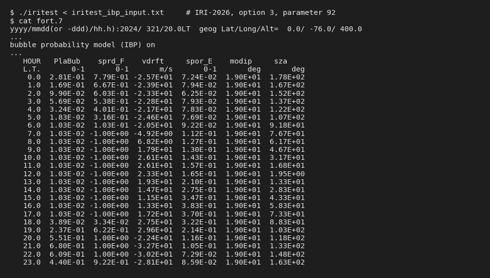
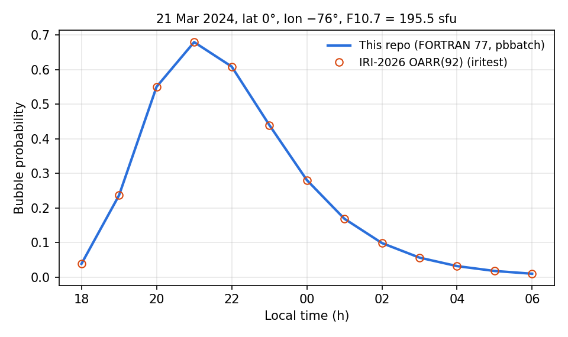
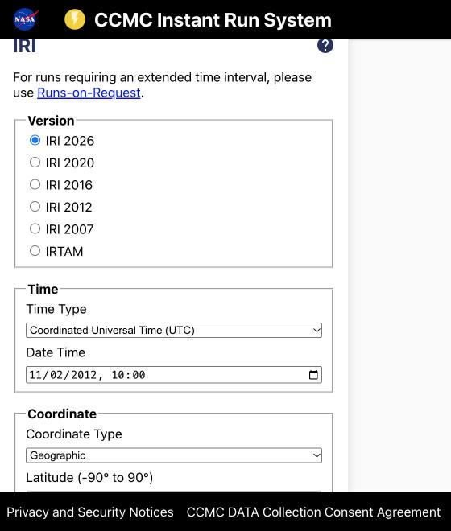

# IBP model — FORTRAN 77 implementation

A portable, fixed-form FORTRAN 77 implementation of the **Ionospheric Bubble
Probability (IBP) model** of Stolle et al. (2024, *Space Weather* 22,
e2023SW003809), which gives the probability of post-sunset equatorial plasma
depletions as a function of day of year, longitude, local time and F10.7.

- Compiles with `gfortran -std=legacy`; no external libraries.
- The probability is evaluated analytically through the error function.
- Coefficients (official IBP release v2.0.2) are read at run time from one
  ASCII file, `ibp_coefficients.txt`.
- Agrees with the official IBP v2.0.2 Python package to a maximum absolute
  probability difference of 2.2×10⁻⁶ over 50,000 random inputs (8.2×10⁻⁷ on
  the 504-case test set), entirely due to the error-function approximation.

> **Now part of IRI-2026.** The FORTRAN 77 IBP model has been included in the
> **International Reference Ionosphere, IRI-2026** (released 28 Sep 2026) as
> the plasma-bubble occurrence probability output. See
> [Using IBP inside IRI-2026](#using-ibp-inside-iri-2026) below.

## Contents

| Folder | Purpose |
|---|---|
| `ibp_single_model_share/` | Library interface (`IBP_INIT`, `IBP_PROBABILITY`) for embedding in a host model, an interactive program and a self-checking test. Start here. |
| `ibp_model_f77/` | Standalone single-run (`pbsingle`) and batch (`pbbatch`) programs. |
| `iri2026/` | Script, `iritest` input and a demo program for getting the IBP output from IRI-2026. |
| `docs/iri2026/` | Snapshots and the comparison figure used in this README. |
| `IBP Plots/`, `ibp plots1/`, `ibp plots 2/` | Earlier exploratory climatology plots and scripts (not part of the paper). |
| `validation/` | Comparison against the official Python package, an independent Python reference, the coefficient converter and the scripts that produce the paper's figures. See `validation/README.txt`. |

## Quick start

```sh
cd ibp_single_model_share
make            # on macOS with Anaconda: make FC="gfortran -B/usr/bin/"
./test_ibp
```

## Using IBP inside IRI-2026

**Links**

- IRI home page: <https://irimodel.org/>
- IRI-2026 source (FORTRAN): <https://irimodel.org/IRI-2026/>
  (`00_iri.tar` / `00_iri.zip`, plus the IBP coefficients `ibp_emp_coeffs.dat`)
- Indices files needed at run time: <https://irimodel.org/indices/>
  (`apf107.dat`, `ig_rz.dat`)
- CCMC Instant Run (web): <https://ccmc.gsfc.nasa.gov/instantrun/iri/>

**Where the model sits in IRI-2026**

| Item | IRI-2026 |
|---|---|
| Subroutines | `IBPEMP` (probability), `IBPFOU` (Fourier helper), `IBPLOD` (coefficient loader), in `irifun.for` |
| Call site | `IRI_SUB` in `irisub.for` |
| Coefficients | `ibp_emp_coeffs.dat` (read on unit 16) |
| On/off switch | `JF(38)` = `.true.` (on by default) |
| Output | `OARR(92)` = plasma bubble occurrence probability (0–1), labelled `PlaBub` in `iritest` |
| Computed when | \|latitude\| ≤ 45° and local time 18–06 h; otherwise `OARR(92)` = −1 |

**Calling it from your own program** (complete, tested example:
[`iri2026/ibp_iri2026_demo.for`](iri2026/ibp_iri2026_demo.for))

```fortran
      CALL READ_IG_RZ
      CALL READAPF107
C     JF(1:50): iritest.for defaults; JF(38)=.TRUE. turns IBP on
      ...
C     pass variables, not constants - IRI_SUB may write to its arguments
      CALL IRI_SUB(JF,JMAG,ALAT,ALON,IYYYY,MMDD,DHOUR,
     &             HBEG,HEND,HSTP,OUTF,OARR)
      PRINT *, 'Bubble probability =', OARR(92)
```

With lat 0°, lon −76°, 21 Mar 2024, 20 LT, 400 km this prints
`Bubble probability = 0.550687`, the same value `pbbatch` gives (0.5506873).

**Step by step with the IRI test program (`iritest`)**

1. Download IRI-2026 and the indices files, then build. The script
   [`iri2026/run_iri2026_ibp.sh`](iri2026/run_iri2026_ibp.sh) does all of
   this and runs the example below:

   ```sh
   cd iri2026
   ./run_iri2026_ibp.sh          # macOS + Anaconda: FC="gfortran -B/usr/bin/" ./run_iri2026_ibp.sh
   ```

   To do it by hand:

   ```sh
   gfortran -std=legacy -w -O1 -o iritest iritest.for irisub.for irifun.for \
       iritec.for iridreg.for igrf.for cira.for iriflip.for rocdrift.for
   ```

2. Run `./iritest` and answer its prompts. The answers used here are in
   [`iri2026/iritest_ibp_input.txt`](iri2026/iritest_ibp_input.txt):

   | Prompt | Answer | Meaning |
   |---|---|---|
   | `jmag, lati, long` | `0,0.,-76.0` | geographic, equator, Jicamarca longitude |
   | `year, mmdd, iut, hour` | `2024,0321,0,20.` | 21 March 2024, local time |
   | `height/km` | `400.` | any height in the F region |
   | `variable?` | `8` | vary the hour |
   | `begin, end, step` | `0.,23.,1.` | 00–23 LT |
   | `output-option` | `3` | "6 parameters of your choice" |
   | `TEC heights` | `0,0` | no TEC |
   | `Options (50)` | `0` | standard switches (IBP on) |
   | `6 parameters` | `92,48,44,91,27,23` | **92 = plasma bubble probability** |

3. The table goes to `fort.7`. The `PlaBub` column is the IBP result:

   

   Only the night-time rows (18–06 LT) are meaningful. In the current
   IRI-2026 release, daytime rows repeat the last night-time value
   (`1.03E-02` above) instead of −1, so ignore `PlaBub` between 06 and 18 LT.

**Agreement with this repository.** At the same inputs, the IRI-2026 output
and `pbbatch` from this repository agree to within 5×10⁻⁴ (the 3 significant
figures that `iritest` prints). IRI-2026 truncates longitude to a whole degree
before evaluating the model, so at fractional longitudes the two can differ by
a few ×10⁻³.



**CCMC Instant Run.** The CCMC web interface already offers *IRI 2026* as a
version. As of 24 Nov 2026, its "Choice of 6 output parameters" list ends at
`spor_E` (parameter 91), so the bubble probability is not yet selectable
online. Use the local run above until CCMC adds parameter 92.



## Reference

Stolle, C., et al., 2024. Space Weather 22, e2023SW003809.
The accompanying paper describing this implementation is under review.

## Citing this code

If you use this implementation, please cite it together with Stolle et al.
(2024). Citation details are in [`CITATION.cff`](CITATION.cff); GitHub's
"Cite this repository" button (right-hand sidebar) gives them in APA and
BibTeX form.

## License

Released under the [MIT License](LICENSE). The IBP model coefficients come
from the official IBP v2.0.2 release (Stolle et al., 2024).
